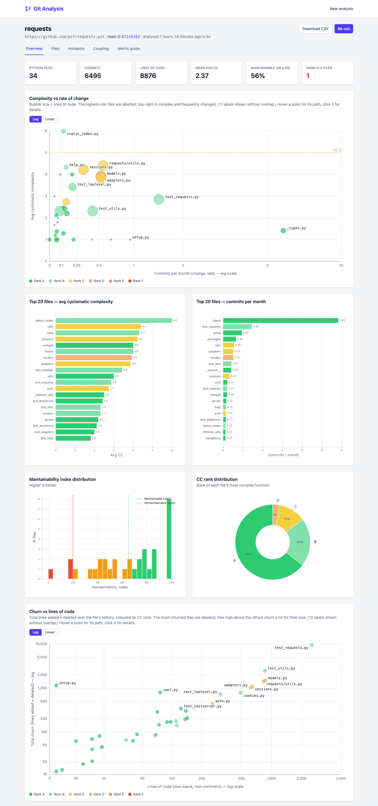
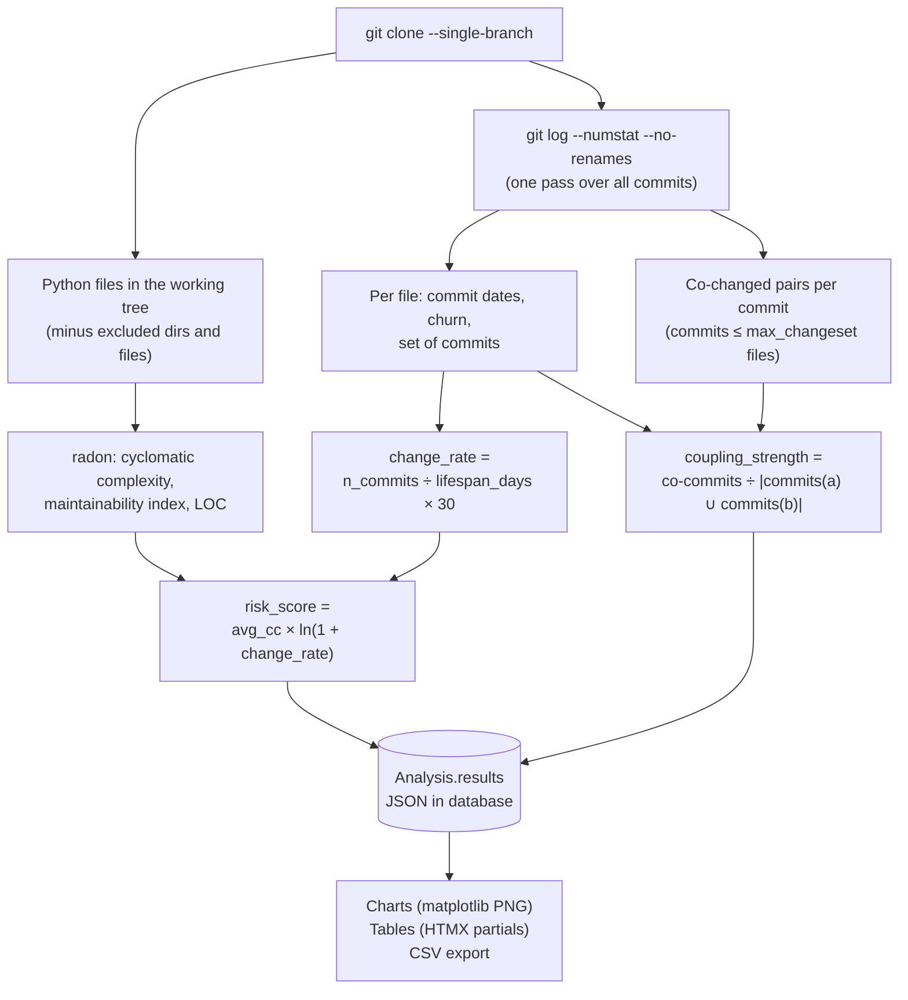
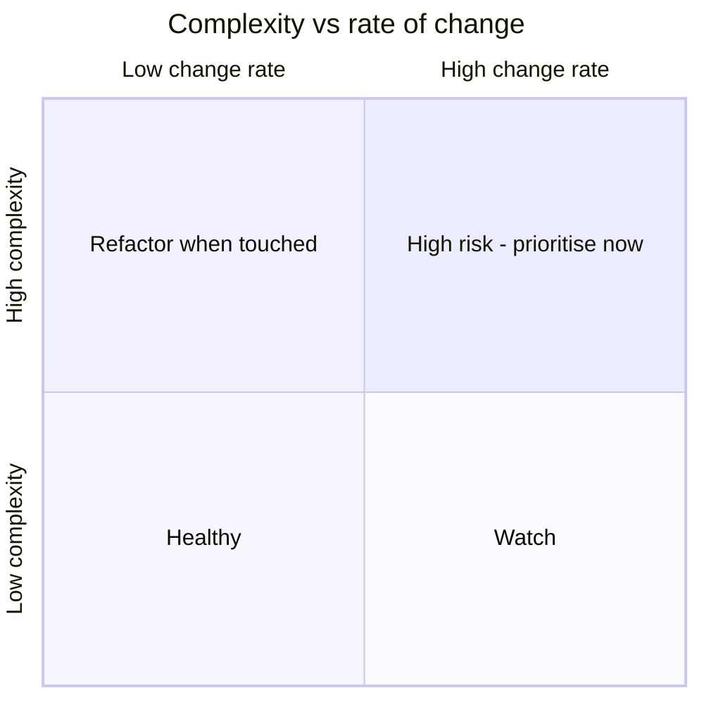
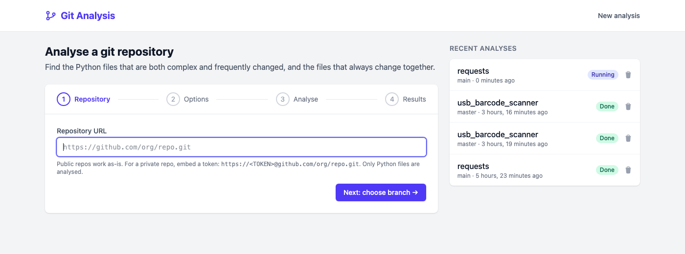
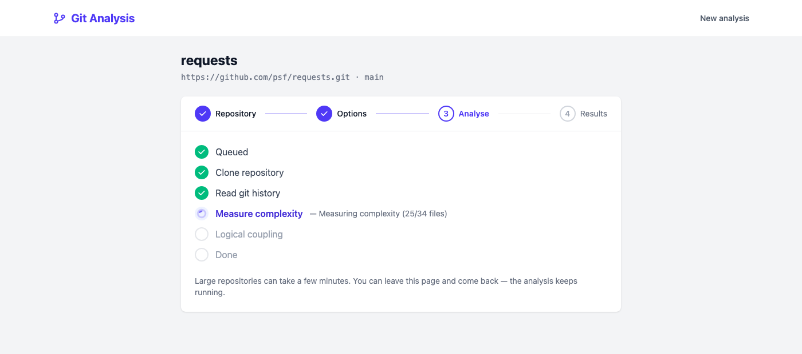
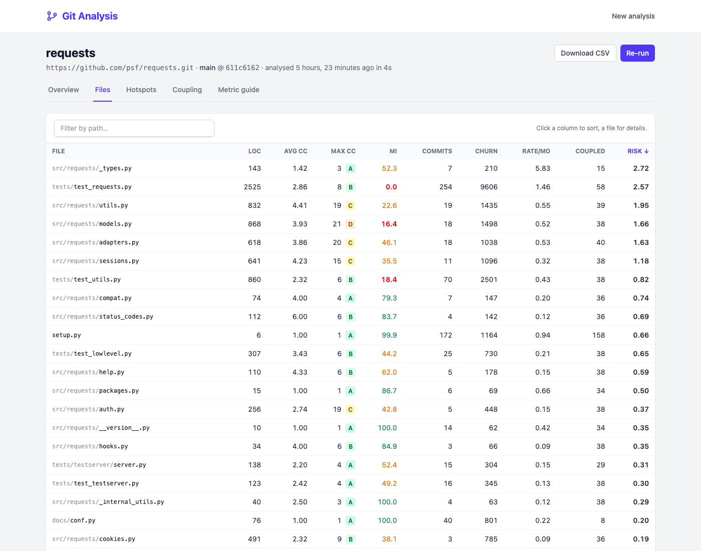
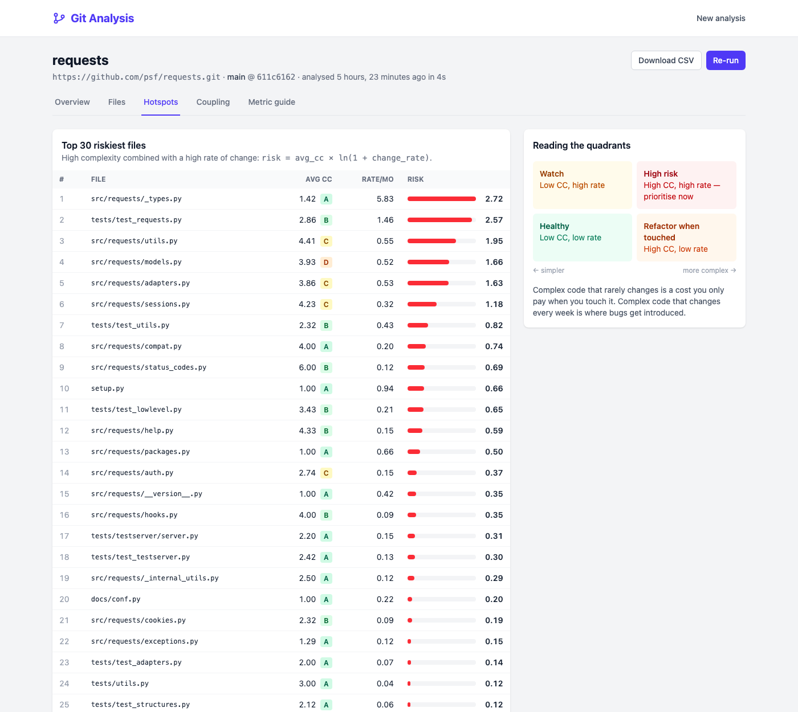
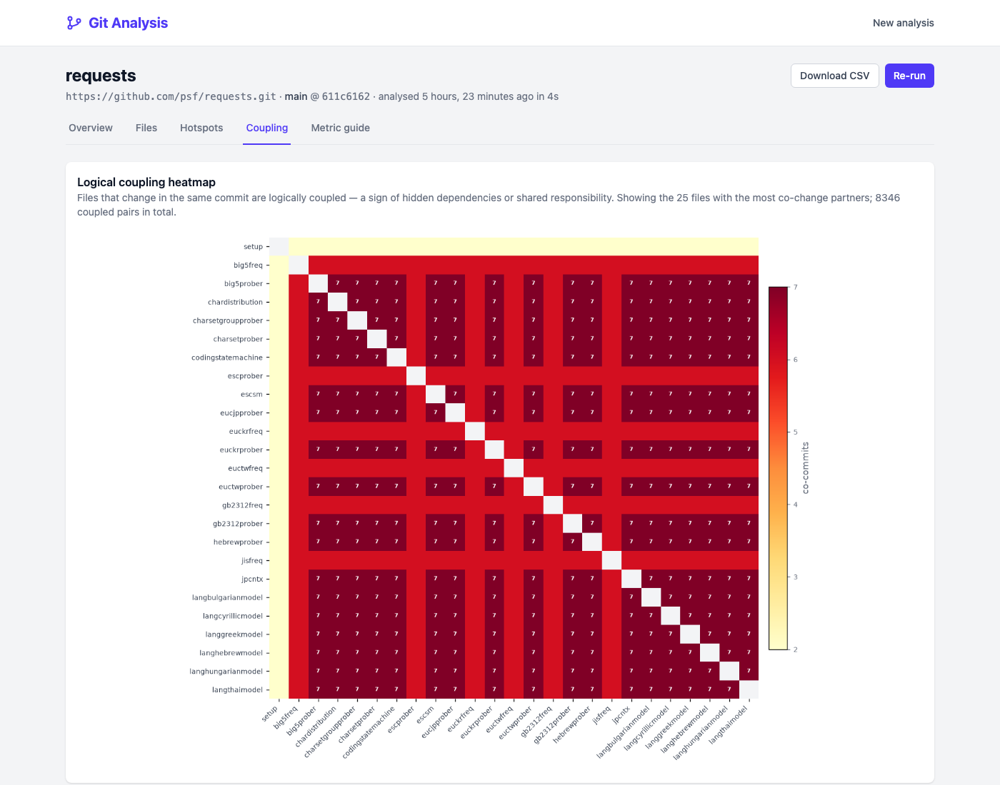
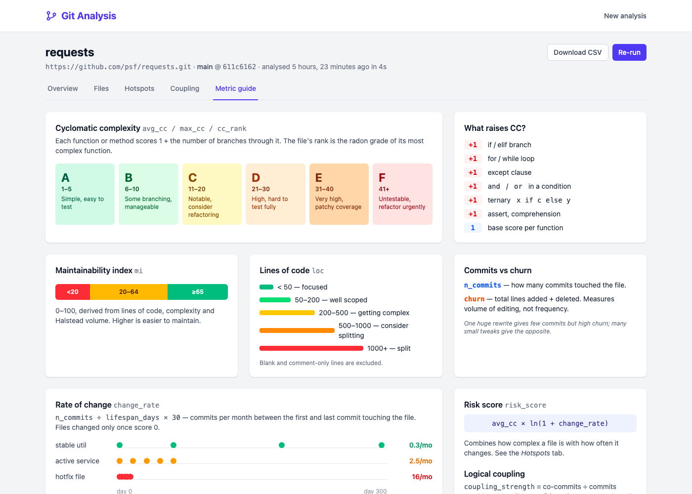

# Git Analysis

A small web tool that analyses a git repository's **Python code quality alongside its change history**. It answers three questions:

1. **Which files are hard to understand and test?** (cyclomatic complexity, maintainability index)
2. **Which files change the most?** (commit frequency, churn)
3. **Which files always change together?** (logical coupling)

Combining (1) and (2) gives a ranked list of **hotspots**: complex code that keeps getting edited, which is where bugs and slow delivery tend to concentrate.

> **Inspired by Adam Tornhill's book [*Your Code as a Crime Scene*](https://pragprog.com/titles/atcrime2/your-code-as-a-crime-scene-second-edition/)** (2nd edition, Pragmatic Bookshelf). The book 
> borrows from forensic psychology: just as investigators map where crimes cluster, we can mine version-control history to find where problems in a codebase cluster. Hotspot analysis (complexity × 
> change frequency) and change coupling both come from that approach. This tool is a small, Python-focused take on those ideas. If you find it useful read the book! : it goes much further, covering team dynamics, knowledge loss and architectural decay.

The tool started as a Jupyter notebook ([`notebooks/git_code_quality.ipynb`](notebooks/git_code_quality.ipynb)) and is now a Django app with an HTMX-driven, multi-step interface styled with Tailwind CSS.



---

## Contents

- [Intended purpose](#intended-purpose)
- [How it works](#how-it-works)
- [The metrics and why they matter](#the-metrics-and-why-they-matter)
- [Screenshots](#screenshots)
- [Installation](#installation)
- [Running](#running)
- [Configuration](#configuration)
- [Project layout](#project-layout)
- [Limitations and caveats](#limitations-and-caveats)
- [References](#references)
- [License](#license)

---

## Intended purpose

Git Analysis is meant to **guide a long term code clean up process, not deliver a verdict**. Suggested uses are:
- **Prioritising refactoring:** spend valuable time on files that are both complex *and* frequently changed rather than on the complex code nobody touches. (It works but isn't elegant so why worry?)
- **Onboarding and code review:** see where the tricky parts of an unfamiliar codebase are.
- **Spotting hidden dependencies:** files that always change together but live in different modules often point to a missing abstraction or a leaking responsibility.
- **Tracking code health metrics:** re-run the analysis periodically and compare the results.

It is not a linter, a test-coverage tool or a measure of developer productivity or skill(!) See [Limitations and caveats](#limitations-and-caveats).

---

## How it works


### Analysis pipeline

When you start an analysis, a background thread clones the repository into a temporary directory and runs the pipeline below. Progress is written to the database after each stage, and the browser 
polls for it. The temporary clone is deleted afterwards and only the computed results (JSON) are kept.



---

## The metrics and why they matter

| Metric | What it measures | Why it matters |
|---|---|---|
| **`avg_cc`** | Mean [cyclomatic complexity](#references) of the functions in a file | Each extra branch is another path to understand and test. High average complexity means the file as a whole is hard to reason about. |
| **`max_cc`** / **`cc_rank`** | Complexity of the single worst function, and its radon grade A–F | One very complex function can be a testing blind spot even when the file average looks fine. |
| **`mi`** | Maintainability Index, 0–100, combining Halstead volume, complexity and LOC | A single "how hard is this to maintain" signal. Below 20 is generally considered unmaintainable, 65 and above maintainable. |
| **`loc`** | Non-blank, non-comment lines | Size alone predicts defects surprisingly well, and very large files usually hold more than one responsibility. |
| **`n_commits`** | Number of commits that touched the file | How often people need to change it. |
| **`churn`** | Lines added + deleted across all commits | How much editing happens. Relative churn is a well-studied predictor of defect density. |
| **`change_rate`** | Commits per month over the file's active lifespan | Normalises `n_commits` by age, so old and new files can be compared. |
| **`risk_score`** | `avg_cc × ln(1 + change_rate)` | **The hotspot metric.** Complex code that rarely changes costs you little; complex code that changes every week is where defects get introduced. The log damps extreme change rates. |
| **`coupling_strength`** | Co-commits ÷ commits touching either file (Jaccard index, 0–1) | Files that change together without an explicit dependency suggest hidden coupling, duplicated logic or a shared responsibility. |
| **`coupling_degree`** | Number of distinct co-change partners | Files that change with *everything* (settings, URL routers, god objects) are change magnets. |

### Reading the hotspot quadrants



### Complexity grades (using 'radon' the Python complexity tool)

| Grade | CC | Interpretation |
|:-:|:-:|---|
| A | 1–5 | Simple, low risk |
| B | 6–10 | Well structured, some branching |
| C | 11–20 | Moderately complex |
| D | 21–30 | More complex, harder to test |
| E | 31–40 | Complex, alarming |
| F | 41+ | Very high risk, effectively untestable |

---

## Screenshots

Screenshots were taken with the example repo: [`psf/requests`](https://github.com/psf/requests).

**Step 1: enter a repository**


**Step 2: choose a branch and options**


**Step 3: live progress**


**Step 4: results**

| |                                                   |
|---|---------------------------------------------------|
| **Overview:** KPIs, interactive complexity-vs-change and churn-vs-LOC scatters (hover for paths, log/linear scale), the notebook charts, summary statistics | **Files:** sortable and filterable table          |
|  |             |
| **Hotspots:** top 30 by risk score | **Coupling:** heatmap, top pairs, coupling degree |
|  |       |
| **Metric guide:** in-app explainer | **File detail panel**                             |
|  | Not shown                                         |

---

## Installation

### Requirements

- Python **3.13+**
- **git** on the `PATH` (the app shells out to `git ls-remote`, `git clone` and `git log`)
- [uv](https://docs.astral.sh/uv/) (recommended) or pip
- The Tailwind CSS standalone CLI is downloaded automatically by `django-tailwind-cli`. No Node.js needed.

### Steps

```bash
git clone <this-repo-url> git-analysis
cd git-analysis

# create the virtualenv and install dependencies
uv sync
# or, without uv:
#   python -m venv .venv
#   .venv/bin/pip install django django-htmx django-tailwind-cli radon matplotlib numpy

# create the database
uv run python manage.py migrate

# build the stylesheet (assets/css/tailwind.css)
uv run python manage.py tailwind build
```

---

## Running

### Development server

```bash
uv run python manage.py runserver
```

Open <http://127.0.0.1:8000>. While working on templates, run Tailwind in watch mode instead, so the CSS rebuilds as classes change:

```bash
uv run python manage.py tailwind runserver
```

### Tests

```bash
uv run python manage.py test analyzer
```

The tests build a throwaway git repository with known commits and check the metrics, the coupling maths, every view, every chart and the URL validation.

### Notebook

The original exploratory notebook still works:

Open `notebooks/git_code_quality.ipynb` in VS Code, PyCharm or Jupyter, using the project's `.venv` as the kernel (`ipykernel`, `polars`, `pandas` and `gitpython` are included in the dependencies).

---

## Configuration

Settings live in `git_analysis/settings.py`:

| Setting | Default | Purpose |
|---|---|---|
| `GIT_ANALYSIS_ALLOW_SSH` | `DEBUG` | Allow `git@host:org/repo.git` / `ssh://` URLs. These use **the server's** SSH keys. |
| `GIT_ANALYSIS_ALLOW_LOCAL` | `DEBUG` | Allow local filesystem paths. These read **the server's** disk. |
| `GIT_ANALYSIS_MAX_CONCURRENT` | `2` | Analyses running at once. Others wait in a queue. |
| `GIT_ANALYSIS_CLONE_TIMEOUT` | `900` | Seconds before a clone is abandoned. |
| `GIT_ANALYSIS_RUN_SYNC` | `False` | Run analyses inline rather than in a thread (used by the tests). |
| `GIT_ANALYSIS_REPO_HOSTS` | `{}` | Map self-hosted servers to their web UI so file names link to the source, e.g. `{"git.example.com": "gitlab"}`. |

Per-analysis options (in step 2 of the wizard):

- **Branch:** defaults to the remote's default branch.
- **Exclude directories:** default `migrations, __pycache__, .git, venv, .venv, node_modules`.
- **Exclude file names:** default `__init__.py`.
- **Max files per commit for coupling:** default `100`. Larger commits are ignored when computing coupling.

For a private repository over HTTPS, embed a personal access token: `https://<TOKEN>@github.com/org/repo.git`. The token is masked in the UI.

### Links to source

Wherever a file name appears in the reports (Files, Hotspots, Coupling, the file detail panel, and the `url` column of the CSV export), it links to that file on the hosting service. The analysed commit SHA in the page header links to the commit. Links are **permalinks to the analysed commit**, so they show the code exactly as it was measured, even after the branch moves on.

| Host | Detected when the host name contains | File link format |
|---|---|---|
| GitHub (incl. Enterprise) | `github` | `https://host/org/repo/blob/<sha>/<path>` |
| GitLab (incl. self-managed) | `gitlab` | `https://host/group/repo/-/blob/<sha>/<path>` |
| Bitbucket Cloud | `bitbucket` | `https://host/team/repo/src/<sha>/<path>` |

Any other host gets no links unless it's mapped in `GIT_ANALYSIS_REPO_HOSTS`. HTTPS, SSH and `git@host:org/repo` URLs are all understood, and credentials are never included in links. Local-path analyses have no links, and neither do files that no longer exist at the analysed commit (e.g. deleted files that appear in coupling pairs).

---

## Project layout

```
analyzer/
  analysis.py      # core logic: git plumbing, radon metrics, coupling (no Django dependency)
  runner.py        # background threads, concurrency limit, progress updates
  bubble.py        # geometry, log axes + label placement for the interactive SVG scatter charts
  charts.py        # matplotlib charts rendered to PNG
  links.py         # file/commit permalinks for GitHub, GitLab, Bitbucket
  forms.py         # URL / branch validation
  models.py        # Analysis model (status, stage, results JSON)
  views.py         # wizard, progress polling, result tabs, partials, CSV
  templatetags/    # rank colours, sort links, wizard stepper
  tests.py
templates/
  base.html
  analyzer/        # pages, tabs/ and partials/ for HTMX swaps
notebooks/
  git_code_quality.ipynb   # the original analysis
docs/screenshots/
```

---

## Limitations and caveats

**About the metrics**

- **Correlation, not causation.** Hotspots are where problems *tend* to be, not proof that they are there. Use the results to decide where to look, then read the code.
- **Python only.** Complexity comes from [radon](https://radon.readthedocs.io/), which parses Python. Other languages are ignored entirely, including their history and coupling.
- **Files that fail to parse** (e.g. Python 2 syntax) get no complexity score and no risk score. They still appear in the tables with `—`.
- **`avg_cc` can hide problems.** One awful function among many trivial ones averages out, so check `max_cc` / `cc_rank` as well.
- **Change rate is noisy for young files.** A file with 2 commits a day apart scores ~60 commits/month. Files committed only once score 0.
- **Commits are not equal.** A typo fix and a rewrite each count as one commit. Churn partly compensates.
- **Renames break history.** The analysis uses `--no-renames`, so a moved file starts again with fresh history under its new path, and its old path shows up in coupling as a file that no longer exists.
- **Merge commits** contribute no file changes, which avoids double-counting work already in the merged branch. The original notebook (via GitPython) did count them, so numbers can differ slightly.
- **Vendored, generated or bulk-edited code skews coupling.** In the `requests` screenshot above, a library that was once vendored into the repo (chardet) dominates the heatmap. Add such directories to the exclusions, and tune *max files per commit*, which drops reformatting and mass-rename commits.
- **Coupling is lossy.** Only the top 2,000 pairs are stored, and the heatmap shows the 25 files with the highest coupling degree.
- **Tests count too.** Test files are analysed like any other code. Exclude `tests` if you only care about production code.

**About the tool**

- **Not production-hardened.** Analyses run in in-process threads. If the server restarts mid-run, that analysis stays "running" forever. For real deployments use a task queue (Celery, RQ, Django tasks) and set `DEBUG=False`, a real `SECRET_KEY` and `ALLOWED_HOSTS`.
- **No authentication.** Anyone who can reach the server can start analyses, see everyone's results and delete them.
- **Untrusted repositories.** The app clones arbitrary URLs. Git prompts are disabled and only the `https`, `ssh` and `file` transports are allowed, but cloning very large repositories still costs disk, CPU and time. Keep SSH and local paths disabled on any shared server.
- **Tokens are stored** in plain text in the database as part of the repository URL, even though the UI masks them.
- **Full clones.** The whole history of the chosen branch is cloned, which is slow for very large repositories.
- **Some charts are static images.** The *Complexity vs rate of change* and *Churn vs lines of code* charts are interactive SVG: hover a point for its path and metrics, click it for the detail panel and source link. Both default to log scales (`ln(1 + x)`, so zero still plots) with a Linear toggle. The other charts are matplotlib PNGs, so use the Files and Hotspots tables for exact values. Only 12 files per scatter get labels (highest risk, or most churn), and a label is dropped if it would overlap another.
- **Source links assume the web UI path conventions** of GitHub, GitLab and Bitbucket Cloud. Bitbucket Server/Data Center, Gitea, Azure DevOps and other hosts aren't supported yet. Links to private repositories only work for viewers who have access there.

---

## References

**Cyclomatic complexity**
- T. J. McCabe, "A Complexity Measure," *IEEE Transactions on Software Engineering*, SE-2(4), 1976. <https://doi.org/10.1109/TSE.1976.233837>
- Radon documentation: complexity ranks and metrics. <https://radon.readthedocs.io/en/latest/intro.html>

**Maintainability index and Halstead metrics**
- M. H. Halstead, *Elements of Software Science*, Elsevier, 1977.
- D. Coleman, D. Ash, B. Lowther, P. Oman, "Using Metrics to Evaluate Software System Maintainability," *IEEE Computer*, 27(8), 1994. <https://doi.org/10.1109/2.303623>
- Microsoft, "Code metrics – Maintainability index range and meaning." <https://learn.microsoft.com/en-us/visualstudio/code-quality/code-metrics-maintainability-index-range-and-meaning>

**Churn and change history as defect predictors**
- N. Nagappan, T. Ball, "Use of Relative Code Churn Measures to Predict System Defect Density," *ICSE 2005*. <https://doi.org/10.1145/1062455.1062514>

**Hotspots (complexity × change frequency)**
- A. Tornhill, *Your Code as a Crime Scene*, Pragmatic Bookshelf (2nd ed. 2024). <https://pragprog.com/titles/atcrime2/your-code-as-a-crime-scene-second-edition/>
- Code Maat, a command-line tool for mining version-control data. <https://github.com/adamtornhill/code-maat>

**Logical (change) coupling**
- H. Gall, K. Hajek, M. Jazayeri, "Detection of Logical Coupling Based on Product Release History," *ICSM 1998*. <https://doi.org/10.1109/ICSM.1998.738508>
- T. Zimmermann, P. Weißgerber, S. Diehl, A. Zeller, "Mining Version Histories to Guide Software Changes," *IEEE TSE*, 31(6), 2005. <https://doi.org/10.1109/TSE.2005.72>

**Stack**
- [Django](https://www.djangoproject.com/) · [HTMX](https://htmx.org/) · [django-htmx](https://django-htmx.readthedocs.io/) · [Tailwind CSS](https://tailwindcss.com/) · [django-tailwind-cli](https://django-tailwind-cli.rtfd.io/) · [matplotlib](https://matplotlib.org/)

---

## License

This project is licensed under the **GNU General Public License v3.0**. See [`LICENSE`](LICENSE) for the full text, or <https://www.gnu.org/licenses/gpl-3.0.html>.

```
Git Analysis — code quality × change history for git repositories
Copyright (C) 2026  Julian Harley

This program is free software: you can redistribute it and/or modify
it under the terms of the GNU General Public License as published by
the Free Software Foundation, either version 3 of the License, or
(at your option) any later version.

This program is distributed in the hope that it will be useful,
but WITHOUT ANY WARRANTY; without even the implied warranty of
MERCHANTABILITY or FITNESS FOR A PARTICULAR PURPOSE.  See the
GNU General Public License for more details.
```
